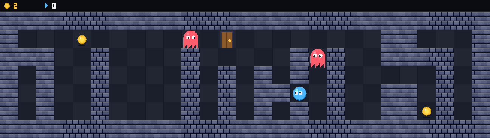
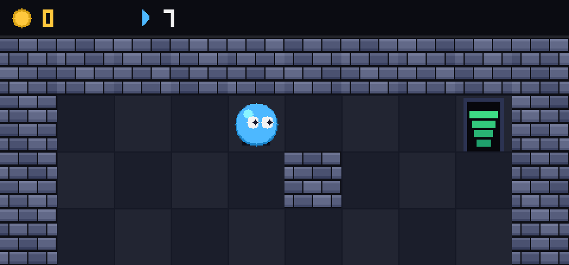
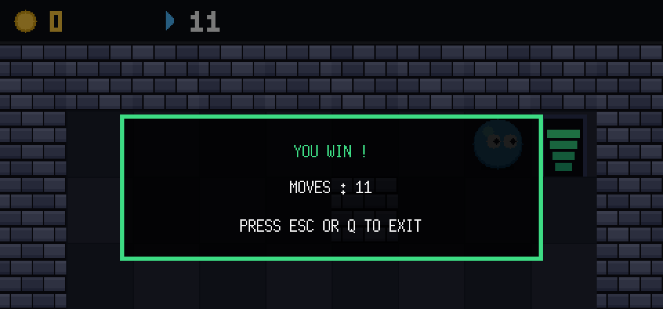

# so_long

A small 2D game in C and MiniLibX. Collect every coin, dodge the ghosts that chase you, reach the door. Every sprite is drawn in code, there are no image files.


| Ghosts chase you through the maze | The door opens when the coins are gone | You win |
| --- | --- | --- |
|  |  |  |

## Quick start

Debian or Ubuntu:

```sh
sudo apt install build-essential libx11-dev libxext-dev
git clone https://github.com/bahbibe/so-long.git
cd so-long
make
./so_long maps/map1.ber
```

On a fresh Ubuntu 24.04 container this builds in about 5 seconds. The game needs a display. On a headless box, run it under `xvfb-run`.

## How to play

| Key | Action |
| --- | --- |
| `W` `A` `S` `D` or arrows | Move |
| `ESC` or `Q` | Quit |

- Take every coin. The door opens when the counter in the top bar reaches 0.
- A ghost that touches you ends the game. Ghosts take the shortest path around walls and step every 450 ms.
- Only moves that change your position are counted.

Maps are plain text files. Write your own with the [map format](docs/map-format.md).

## Notable bits

- **No assets.** Walls, coins, ghosts, the player and the digits in the top bar are drawn with a few pixel primitives into one framebuffer. The old version used 15 XPM files and one `put_image` per tile. The new one copies a pre-drawn background and calls `put_image` once per frame, so it does not flicker.
- **The drawing code needs no display.** It works on a plain buffer, so `make unit` tests it on a `calloc`ed one with guard bytes around it. 43 checks cover clipping, NULL buffers and out of bounds writes.
- **Ghost AI is one BFS.** A distance field from the player is computed once per player move. Each ghost steps to a neighbour that is one closer.
- **The map check does not recurse.** The first flood fill overflowed the stack on a 600 x 600 open map (360,000 cells). It is now a BFS on a heap queue, and a test generates that map.
- **It idles quietly.** The loop draws only when something moves or animates. On a map with one idle ghost that is about 3% of one core, down from 8%.
- **Small.** About 1,400 lines of C in `src/` and `main.c`, and a 57 KB binary.

More detail is in [how it works](docs/how-it-works.md).

## Docs

- [How it works](docs/how-it-works.md): frame, loop, ghosts, map check
- [Map format](docs/map-format.md): characters, start-up checks, error messages
- [Development](docs/development.md): build, tests, ghost speed, source layout

## License

MIT. See [LICENSE](LICENSE). `minilibx-linux/` is third party code with its own license. This started as a 42 school project.

Created by Boubker Ahbibe.
